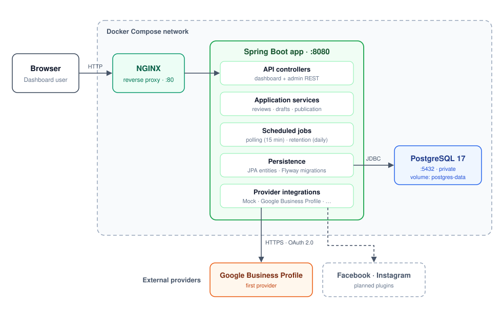
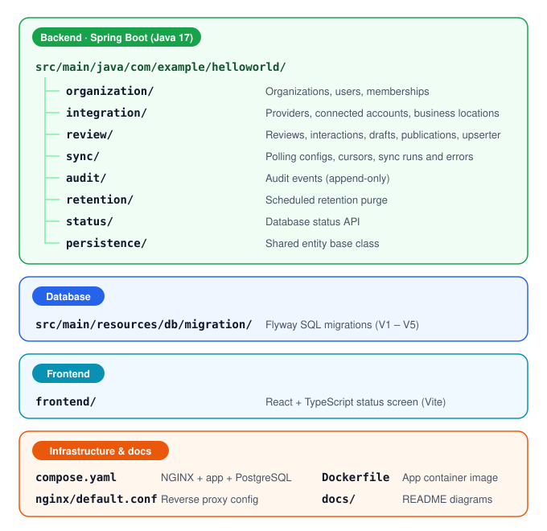

# Social Review & Interaction Management Platform

One dashboard for the reviews and interactions a business gets on social and listing platforms.

The platform connects to external providers and polls them for new and updated reviews. It stores everything in PostgreSQL without duplicates, and lets authorized staff draft and publish replies from one place. **Google Business Profile** is the first provider. Facebook, Instagram and other providers can be added later as plugins, without rewriting the core.

---

## Why

A business with several locations gets reviews on several platforms, and each platform has its own inbox. Unanswered reviews get missed, replies are inconsistent, and nobody can see who replied to what. This project pulls everything into one inbox:

- **One inbox:** reviews from every connected provider and location, in one list.
- **Safe replies:** no reply goes out until an authorized user explicitly confirms it, and every action is audited.
- **Built to extend:** each provider implements one shared integration interface, so a new platform does not change the core.
- **Compliant by default:** external content is purged on a schedule to follow each provider's data-retention rules.

## Features

| Area | What it does | Status |
|---|---|---|
| Persistence | PostgreSQL schema managed by versioned Flyway migrations | ✅ Done |
| Deduplication | Unique keys on provider IDs plus `INSERT … ON CONFLICT` upserts | ✅ Done |
| Retention | Daily purge of expired provider content and old operational data | ✅ Done |
| Audit trail | Append-only `audit_events` table; a trigger blocks updates | ✅ Done |
| Status screen | React dashboard for DB health, migrations, table sizes, retention and sync errors | ✅ Done |
| Provider interface | Pluggable contract for auth, discovery, fetching, publishing and health | 🚧 Planned |
| Polling engine | Scheduled sync (15 min default), pagination, incremental cursors, backoff, no overlapping runs | 🚧 Planned |
| Mock provider | Generates and updates fake reviews for demos and tests | 🚧 Planned |
| Google Business Profile | OAuth 2.0, account/location discovery, review sync, owner replies | 🚧 Planned |
| Review dashboard | Overview, filterable inbox, draft editor, publish confirmation, integration settings | 🚧 Planned |
| Security | Spring Security login for the dashboard and admin APIs | 🚧 Planned |
| Staging | HTTPS deployment behind NGINX on a dedicated subdomain | 🚧 Planned |

## Architecture

Only NGINX is published to the host. The Spring Boot app and PostgreSQL stay on the private Compose network. Provider integrations call external APIs over HTTPS with OAuth 2.0.

### Data model

| Migration | Tables | Purpose |
|---|---|---|
| V1 | `organizations`, `app_users`, `organization_memberships` | Tenants and the people who use the dashboard |
| V2 | `integration_providers`, `connected_accounts`, `business_locations` | Connected platforms, accounts and locations or pages |
| V3 | `reviews`, `interactions`, `response_drafts`, `response_publications` | Synced content and our replies |
| V4 | `polling_configurations`, `sync_cursors`, `sync_runs`, `sync_errors` | Poll schedules, incremental cursors and sync history |
| V5 | `audit_events` | Append-only record of user actions |

Each record keeps the provider's own identifiers next to the normalized internal fields, so one organization can manage many accounts and locations on many providers.

### Project layout

## Getting started

> 🚧 **Coming soon.** Setup and run instructions will be added once the first milestone is complete.
